<p align="center">
  
</p>

# Cope Telemetry

[English](#english) | [Türkçe](#türkçe)

## English

Cope Telemetry is a Flask dashboard for viewing a local Copilot session
database read-only. It includes overview, usage, agents, performance,
efficiency analysis, sessions, and activity pages. The server listens only on
`127.0.0.1`.

### Features

- Filter token, AI credit, session, and performance metrics.
- Compare efficiency by model, agent, and project.
- Use a local SQLite database or demo data that contains no actual usage.
- Switch between English and Turkish.

### Privacy first: local and offline

Cope Telemetry is designed to run on your computer.

- No cloud service or external server is required.
- After installation, the dashboard does not require an internet connection.
- Telemetry data stays on your computer; the app does not send it to third-party
  services.
- The local Copilot database is opened read-only. Analysis runs locally, and
  your session history stays under your control.

### Supported Copilot data sources and compatibility

- **Local SQLite:** `$COPILOT_HOME/session-store.db`; if `COPILOT_HOME` is unset
  or empty, `~/.copilot/session-store.db` is used.
- **Agent metadata:** `session-state/<session-id>/events.jsonl` files beside the
  database. Missing files leave agent names and statuses unavailable.
- **Demo data:** generated sample records, not actual Copilot usage. Cloud APIs
  and other import formats are not supported.
- **Runtime:** Python 3.11 or later and Flask `>=3.1,<4`.
- **Copilot compatibility:** no Copilot release-version range is declared.
  Compatibility depends on the SQLite schema. The dashboard expects the
  `sessions`, `assistant_usage_events`, `turns`, `session_files`, and
  `forge_trajectory_events` tables. Some extended usage columns are optional;
  missing optional fields are treated as unavailable. Missing required tables
  or columns can cause read errors. The database is read-only and is not
  migrated.

### Screenshots

The screenshots show demo data only.

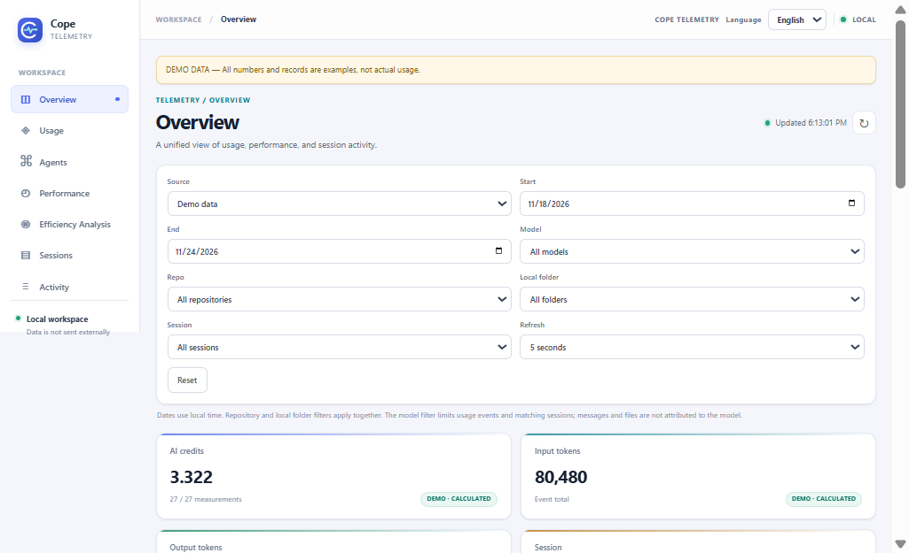

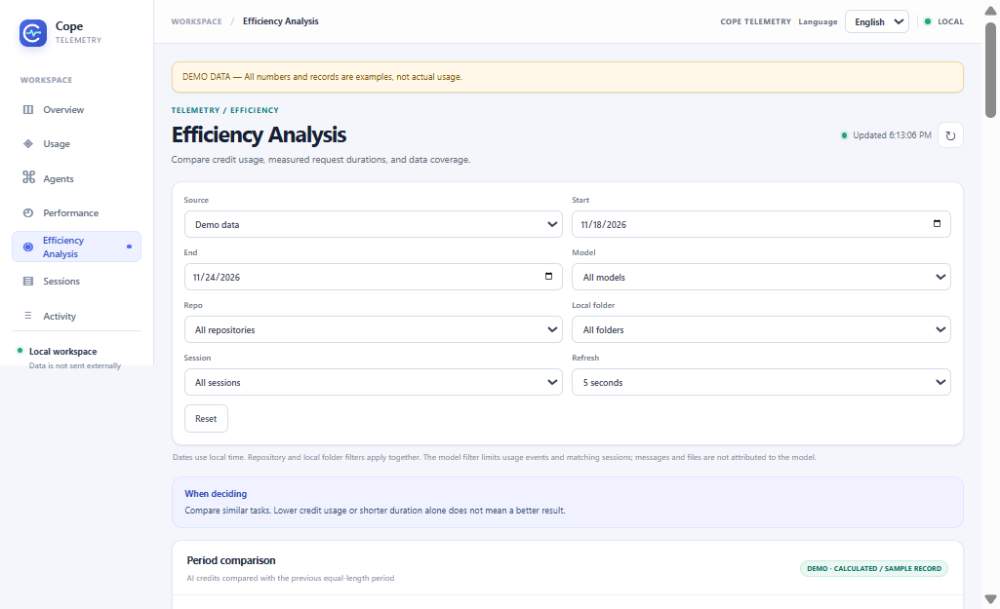

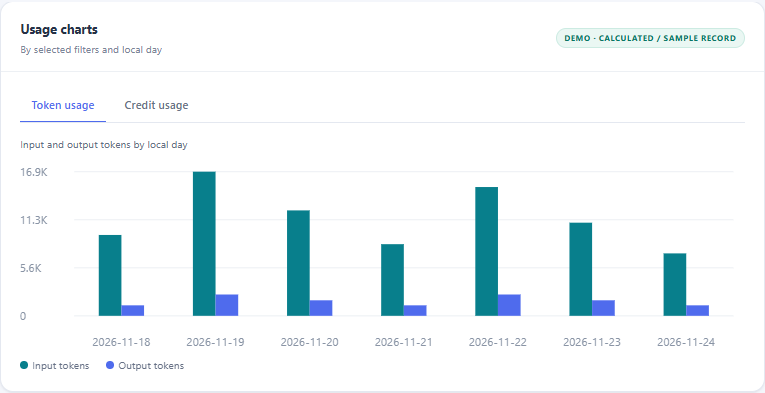

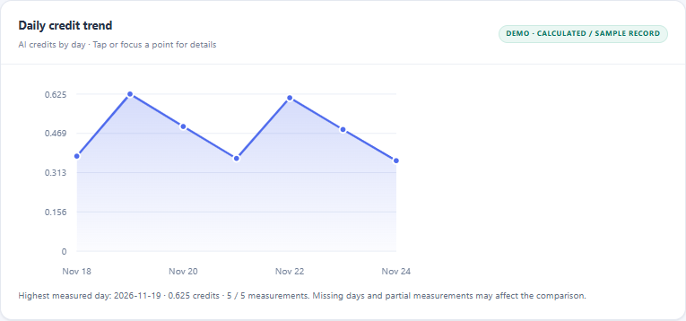

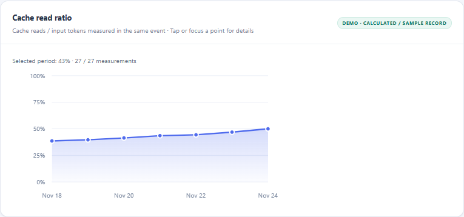

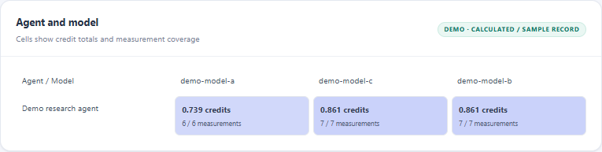

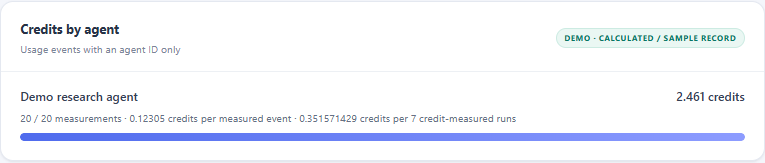

### Installation and running

Python 3.11 or later is required.

Windows (PowerShell):

```powershell
python -m venv .venv
.\.venv\Scripts\python -m pip install -r requirements.txt
.\.venv\Scripts\python dashboard.py
```

macOS / Linux (bash or zsh):

```bash
python3 -m venv .venv
./.venv/bin/python -m pip install -r requirements.txt
./.venv/bin/python dashboard.py
```

Open `http://127.0.0.1:5000` in your browser. The application displays
**Local SQLite** data by default. For sample data, select **Demo data** in
the Source filter. The database is sought at `$COPILOT_HOME/session-store.db`.
If `COPILOT_HOME` is unset or empty, it uses `.copilot/session-store.db` in
the user's home directory: typically `%USERPROFILE%\.copilot\session-store.db`
on Windows and `~/.copilot/session-store.db` on macOS and Linux. If a custom
`COPILOT_HOME` path is missing, the application reports an error instead of
silently switching databases.

Choose English or Turkish with the **Language** selector in the top bar.
English is the default. The preference is stored in a local browser cookie for
one year; the page and filters are preserved. Changing language hides any open
session content again. The default refresh interval is five seconds; change it
in the interface or select manual refresh. The preference is stored in the
browser. Automatic refresh runs only while the page is visible. Message and
command contents are shown only when explicitly enabled for the selected
session. File paths and repository names can also contain sensitive information.
The application does not send data externally.

The default date range covers the last seven days, including today, in local
time. Sessions with an empty repository field are also listed and can be
selected with the local folder filter. Usage metrics are calculated by event
date. The model filter selects sessions that used the model in the chosen
period; messages, files, and commands are not attributed to the model. File
activity is shown by `session_files.first_seen_at`; this does not mean every
file change is recorded. Commands are shown only from `forge_trajectory_events`
records.

The AIU value is the database's total nano-AIU divided by one billion: one
billion nano-AIU equals one AI credit. It represents usage reported by local
events, not an account-wide balance, a monetary amount, or the former premium
request count. Missing credit records produce partial totals, and measurement
coverage is shown. On the overview page, tabs switch between token and credit
charts. The credit chart shows daily totals; its coverage table reports each
day's measurement count, partial totals, and missing values. The performance
page's model table shows total AI credits and credit measurement coverage for
the selected period. Session details show both the session's total credits
across all models and dates and the credits matching the selected date and
model filters. The back button in session details clears the selection and
returns to the matching session list while preserving the other filters.
Missing measurements are excluded from averages and measurement counts. P95
uses the nearest-rank method. Cards and table headers identify demo,
calculated, recorded, and unavailable values.

The agents page groups usage events by session and agent ID. To obtain agent
names and their last recorded status, it reads only agent events in the relevant
sessions' `session-state/<session>/events.jsonl` files, read-only; message and
task contents are not sent to the dashboard. Events without an agent ID are
not attributed to any agent. Names and credit values without records are
shown as unavailable.

Efficiency Analysis compares credits and measured request durations by model,
agent, and project using the same filters. Long chart lists initially show
eight items; **Show all** reveals the rest. Named agent runs are grouped by
name; unnamed runs are shown separately by session and agent ID. Credits per
run are based on agent runs with at least one credit measurement; totals may
be partial when events are missing.

The previous period has the same length as the selected date range. The cache
ratio uses events that have both input and cache-read measurements, positive
input, and cache reads no greater than input. A consumption spike occurs when
at least three days are measured, credit coverage is complete, and the highest
day is at least twice the average of the other measured days; unused days are
excluded. Focus points in the daily credit and cache-ratio charts with a mouse
or keyboard to see coverage. The line breaks on days without measurements.
Total request duration by project is not actual working time and may include
concurrent requests. Actual working time, credits per working hour, task type,
result quality, and a reliable error rate cannot be inferred from these data.

### Tests

```powershell
.\.venv\Scripts\python -m unittest discover -s tests -v
.\.venv\Scripts\python -m unittest tests.test_dashboard -v
.\.venv\Scripts\python -m unittest tests.test_dashboard.DashboardTests.test_private_content_requires_explicit_request -v
```

On macOS / Linux, replace `.\.venv\Scripts\python` with
`./.venv/bin/python` in the same commands.

### Project documentation

- [Technical documentation](docs/README.md)
- [Contributing](CONTRIBUTING.md)
- [Changelog](CHANGELOG.md)
- [Security policy](SECURITY.md)
- [MIT license](LICENSE)

Before making the repository public, review files, screenshots, and any Git
history for secrets and personal data. `.gitignore` does not remove files
already tracked or data in previous commits.

## Türkçe

Yerel Copilot oturum veritabanını salt okunur görüntüleyen Flask dashboard'u.
Genel bakış, kullanım, agentlar, performans, verimlilik analizi, oturumlar ve etkinlik sayfaları içerir.
Sunucu yalnızca `127.0.0.1` adresini dinler.

### Özellikler

- Token, AI kredisi, oturum ve performans ölçümlerini filtreleyerek inceleme.
- Model, agent ve proje bazında verimlilik analizi.
- Yerel SQLite verisi veya gerçek kullanım içermeyen demo veriler.
- Türkçe ve İngilizce arayüz.

### Gizlilik öncelikli: tamamen yerel ve çevrimdışı

Cope Telemetry kendi bilgisayarınızda çalışacak şekilde tasarlanmıştır.

- Bulut servisi veya harici sunucu gerekmez.
- Kurulumdan sonra dashboard kullanımı internet bağlantısı gerektirmez.
- Telemetry verileriniz bilgisayarınızda kalır; uygulama bunları üçüncü taraf
  servislere göndermez.
- Yerel Copilot veritabanı salt okunur açılır. Analiz bilgisayarınızda çalışır
  ve oturum geçmişiniz sizin kontrolünüzde kalır.

### Desteklenen Copilot veri kaynakları ve uyumluluk

- **Yerel SQLite:** `$COPILOT_HOME/session-store.db`; `COPILOT_HOME`
  tanımlanmamış veya boşsa `~/.copilot/session-store.db` kullanılır.
- **Agent bilgileri:** Veritabanının yanındaki
  `session-state/<oturum-kimliği>/events.jsonl` dosyaları. Dosya yoksa agent
  isimleri ve durumları mevcut değil olarak gösterilir.
- **Demo veriler:** Gerçek Copilot kullanımı olmayan, üretilmiş örnek kayıtlar.
  Cloud API'leri ve diğer içe aktarma biçimleri desteklenmez.
- **Çalışma ortamı:** Python 3.11 veya üzeri ve Flask `>=3.1,<4`.
- **Copilot uyumluluğu:** Belirli bir Copilot sürüm aralığı beyan edilmez;
  uyumluluk SQLite şemasına bağlıdır. Dashboard `sessions`,
  `assistant_usage_events`, `turns`, `session_files` ve
  `forge_trajectory_events` tablolarını bekler. Bazı ek kullanım sütunları
  isteğe bağlıdır; yoksa mevcut değil kabul edilir. Gerekli tablo veya sütunlar
  eksikse okuma hatası oluşabilir. Veritabanı salt okunur açılır ve şema
  geçişi yapılmaz.

### Ekran görüntüleri

Görüntüler yalnızca demo verilerle hazırlanmıştır.

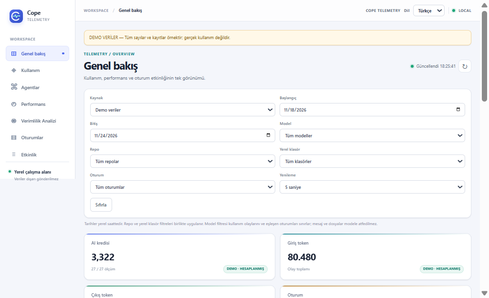

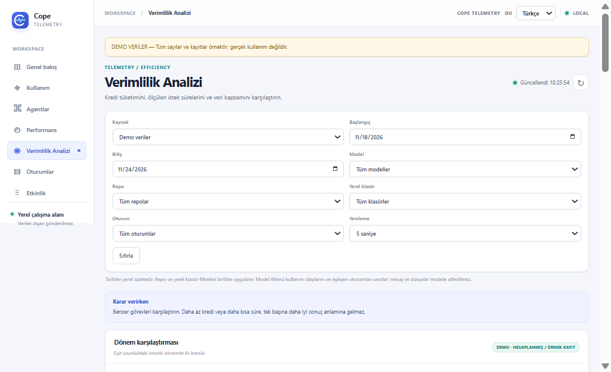

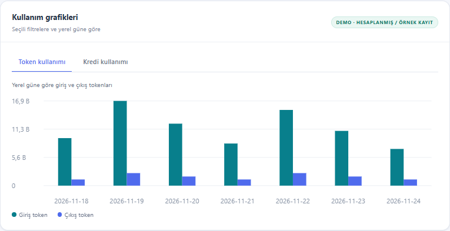

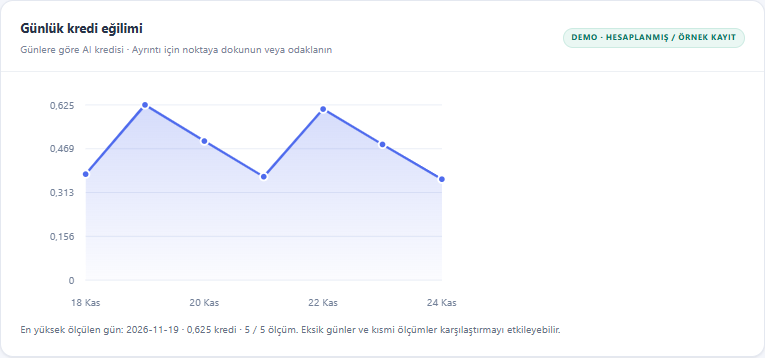

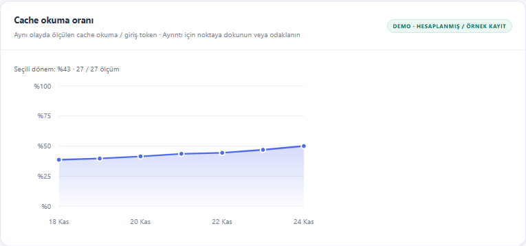

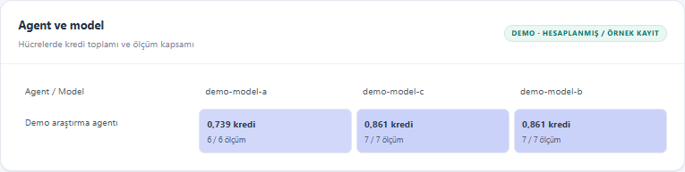

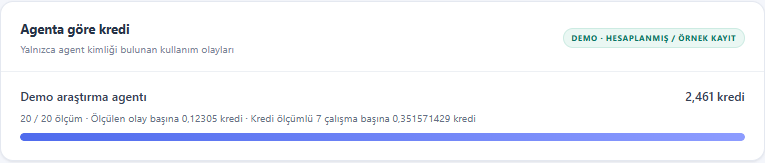

### Kurulum ve çalıştırma

Python 3.11 veya üzeri gereklidir.

Windows (PowerShell):

```powershell
python -m venv .venv
.\.venv\Scripts\python -m pip install -r requirements.txt
.\.venv\Scripts\python dashboard.py
```

macOS / Linux (bash veya zsh):

```bash
python3 -m venv .venv
./.venv/bin/python -m pip install -r requirements.txt
./.venv/bin/python dashboard.py
```

Tarayıcıda `http://127.0.0.1:5000` adresini açın. Uygulama varsayılan olarak
**Yerel SQLite** verilerini gösterir. Örnek veri için Kaynak filtresinde
**Demo veriler** seçin. Veritabanı otomatik olarak `$COPILOT_HOME/session-store.db` yolunda
aranır. `COPILOT_HOME` tanımlı değilse veya boşsa kullanıcının ana dizinindeki
`.copilot/session-store.db` kullanılır. Bu, Windows'ta genellikle
`%USERPROFILE%\.copilot\session-store.db`, macOS ve Linux'ta
`~/.copilot/session-store.db` konumudur. Özel `COPILOT_HOME` yolu eksikse
uygulama hata gösterir; farklı bir veritabanına sessizce geçmez.
Üst çubuktaki **Dil / Language** seçicisinden Türkçe veya İngilizce seçebilirsiniz.
Varsayılan dil İngilizcedir. Tercih bir yıl süreli yerel tarayıcı çerezinde saklanır;
sayfa ve filtreler korunur. Dil değiştirildiğinde açık oturum içeriği yeniden gizlenir.
Varsayılan yenileme aralığı beş saniyedir; ekrandan değiştirilebilir veya manuel
yenileme seçilebilir. Tercih tarayıcıda saklanır. Otomatik yenileme yalnızca
sayfa görünürken çalışır. Mesaj ve komut içerikleri
yalnızca seçilen oturumda açıkça etkinleştirilirse gösterilir. Dosya yolları ve
repo adları da hassas bilgiler içerebilir. Uygulama verileri dışarı göndermez.

Varsayılan tarih aralığı yerel saate göre bugünü de içeren son yedi gündür.
Repo alanı boş olan oturumlar da listelenir; bunları yerel çalışma klasörü
filtresiyle seçebilirsiniz. Kullanım ölçümleri olay tarihine göre hesaplanır.
Model filtresi, seçili dönemde
o modeli kullanmış oturumları seçer; mesaj, dosya ve komutlar modele atfedilmez.
Dosya etkinliği `session_files.first_seen_at` zamanına göre gösterilir; bu,
dosyanın her değişikliğinin kaydedildiği anlamına gelmez. Komutlar yalnızca
`forge_trajectory_events` kayıtlarından gösterilir. AIU değeri
veritabanındaki nano-AIU toplamının milyara bölünmesidir: 1 milyar nano-AIU,
1 AI kredisi eder. Bu değer yerel olayların raporladığı tüketimdir; hesap
genelindeki bakiye, para tutarı veya eski premium istek sayısı değildir.
Eksik kredi kayıtlarında sonuç kısmi toplamdır ve ölçüm kapsamı gösterilir.
Ana sayfada token ve kredi grafikleri sekmelerle seçilir. Kredi grafiği günlük
toplamları gösterir; kapsam tablosu her
günün ölçüm sayısını, kısmi toplamlarını ve bulunmayan değerlerini belirtir.
Performans sayfasındaki model tablosu, seçili dönemin toplam AI kredisini ve
kredi ölçüm kapsamını gösterir.
Oturum ayrıntısında hem oturumun tüm modeller ve tarihler için toplam kredisi,
hem de seçili tarih ve model filtrelerine uyan kredi gösterilir.
Oturum ayrıntısındaki geri düğmesi seçimi temizler ve diğer filtreleri koruyarak
eşleşen oturum listesini geri getirir.
Eksik ölçümler ortalamaya veya ölçüm sayısına dahil edilmez. P95, en yakın
sıra yöntemiyle hesaplanır. Kartlarda ve tablo başlıklarında demo, hesaplanmış,
kayıt ve mevcut olmayan değerler belirtilir.

Agent sayfası, kullanım olaylarını oturum ve agent kimliğine göre toplar.
Agent isimlerini ve son kaydedilen durumlarını almak için yalnızca ilgili
oturumların `session-state/<oturum>/events.jsonl` dosyalarındaki agent olayları
salt okunur incelenir; mesaj veya görev içeriği dashboard'a gönderilmez.
Agent kimliği bulunmayan olaylar herhangi bir agenta atfedilmez. Kaydı
bulunamayan isimler ve kredi değerleri mevcut değil olarak gösterilir.

Verimlilik Analizi, aynı filtrelerle kredi ve ölçülen istek sürelerini model,
agent ve projeye göre grafiklerle karşılaştırır. Uzun grafik listeleri ilk sekiz
öğeyi gösterir; diğerleri "Tümünü göster" ile açılır. Agent adı bulunan çalışmalar
adlarına göre birleştirilir; isimsiz çalışmalar oturum ve agent kimliğiyle
ayrı gösterilir. Çalışma başına kredi, en az bir kredi ölçümü bulunan agent
çalışmalarına dayanır; eksik olaylar için toplam kısmi olabilir.
Önceki dönem seçilen tarih aralığıyla aynı uzunluktadır. Cache oranı, aynı
olayda giriş ve cache okuma ölçümleri bulunan, girişi pozitif ve cache okuması
girişi aşmayan olaylardan hesaplanır. Tüketim sıçraması, en az üç ölçülen gün
ve tam kredi kapsamı olduğunda en yüksek günün diğer ölçülen günlerin
ortalamasının en az iki katına çıkmasıdır; kullanılmayan günler hesaba katılmaz.
Günlük kredi ve cache oranı grafiklerindeki noktalara fareyle veya klavyeyle odaklanarak ölçüm
kapsamı görülebilir. Ölçüm bulunmayan günlerde çizgi kesilir.
Projeye göre toplam istek süresi, gerçek çalışma süresi değildir ve eşzamanlı
istekler içerebilir. Gerçek çalışma süresi, çalışma saati başına kredi, görev
türü, sonuç kalitesi ve güvenilir hata oranı bu verilerden çıkarılmaz.

### Testler

```powershell
.\.venv\Scripts\python -m unittest discover -s tests -v
.\.venv\Scripts\python -m unittest tests.test_dashboard -v
.\.venv\Scripts\python -m unittest tests.test_dashboard.DashboardTests.test_private_content_requires_explicit_request -v
```

macOS / Linux'ta aynı test komutlarında `.\.venv\Scripts\python` yerine
`./.venv/bin/python` kullanın.

### Proje belgeleri

- [Teknik dokümantasyon](docs/README.md)
- [Katkıda bulunma](CONTRIBUTING.md)
- [Sürüm geçmişi](CHANGELOG.md)
- [Güvenlik politikası](SECURITY.md)
- [MIT lisansı](LICENSE)

Depoyu herkese açmadan önce dosyalarınızı, ekran görüntülerinizi ve varsa Git
geçmişini gizli bilgiler ve kişisel veriler açısından inceleyin. `.gitignore`,
zaten izlenen dosyaları veya önceki commit'lerdeki verileri kaldırmaz.
